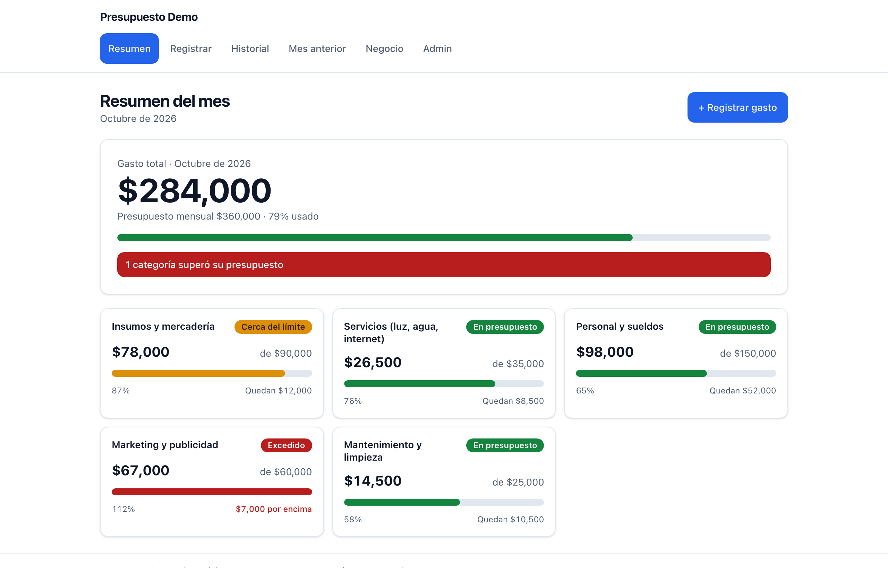
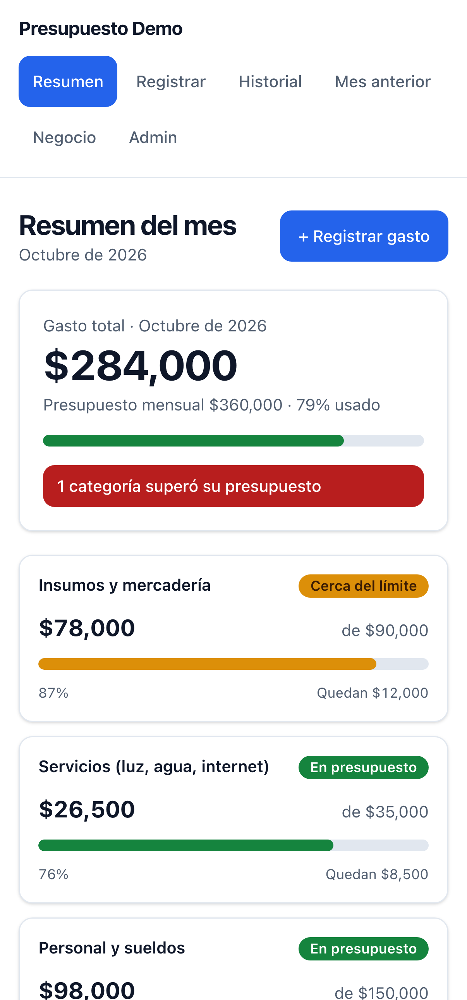

<div align="center">

# 💸 Presupuesto

### A white-label budget tracker that warns a small business when it's overspending.

[](https://react.dev)
[](https://www.typescriptlang.org)
[](https://vite.dev)
[](https://tailwindcss.com)
[](https://supabase.com)
[](#testing)

### [▶  Try the live demo](https://diego-salomon.github.io/presupuesto/)

<sub>Runs entirely in your browser. No sign-up, no backend, pre-loaded with example data.</sub>

<br>



</div>

---

## The problem it solves

Most expense apps report how the month went once it has closed. Presupuesto shows what a small business needs during the month: how much of the budget is left, and which categories are close to going over. A category turns amber at 80% and red once it passes its limit, so overspending is visible while there is still time to hold off on a purchase or adjust an order.

The app is white-label. Change two config files and the palette, and you have a branded, working demo for a client, with no backend to set up or maintain.

## Who it's for

- **Small-business owners** who keep the books in a notebook or a spreadsheet and want to know mid-month whether they're on track, without learning accounting software.
- **Freelancers and agencies** who build tools for small clients and want a finished, branded expense tracker to hand over in an afternoon instead of rebuilding one each time.

## What it does

| | |
|---|---|
| 📊 | **Live budget status.** Total spend against the monthly budget, updated the moment you add an expense. |
| 🚦 | **Early warnings.** Each category reads as on budget (green), close to the limit (amber at 80%), or over (red). |
| 🗂️ | **Spend by category.** See where the money goes, not just a single total. |
| 📅 | **This month next to last.** The two side by side, so a bad month stands out. |
| 📱 | **Works on the phone.** Mobile-first, so it's usable from the shop floor, not only the desk. |
| 🎨 | **White-label in two files.** Name, logo, colors, currency and locale, categories and budgets. Nothing is hard-coded. |

<div align="center">
<br>
<table>
<tr>
<td align="center" width="62%"><br><sub>The month at a glance, on desktop</sub></td>
<td align="center" width="38%"><br><sub>And on the phone</sub></td>
</tr>
</table>
</div>

## Make it yours (white-label)

Everything client-specific lives in two files. No business name, color, currency or string is hard-coded anywhere else.

- [`src/config/brand.config.ts`](src/config/brand.config.ts): name, tagline, logo, palette, locale and currency (these drive every number and date), and contact details.
- [`src/config/presupuesto.config.ts`](src/config/presupuesto.config.ts): categories, their monthly budgets, the warning threshold, the demo password, and the example data.

Fill those in, set the palette, and `pnpm dev` shows the client's full working demo.

## How it's built

Clean architecture, feature-sliced, dependencies pointing inward only. The domain and application layers are pure and fully unit-tested, with no framework and no I/O.

```
src/
  config/          white-label config (brand + presupuesto): the only files a client edits
  shared/          domain primitives (money, dates, Result), formatting, UI kit
  features/
    budgets/       budget status, monthly overview    ┐
    expenses/      expense validation, history, seed   │ each split into
    comparison/    previous-month comparison           │ domain / application /
    admin/         admin gate, budget editing          │ infrastructure / ui
    business-info/                                      ┘
  app/             composition root (container.ts), routing, store wiring
  infrastructure/  Supabase client
```

The backend sits behind two small ports (`ExpenseRepository`, `BudgetRepository`). The same code runs two ways, chosen by one env variable:

- **Demo mode** (`VITE_MODE=demo`, default): everything in the browser on `localStorage`, pre-seeded. For sales demos and portfolios.
- **Live mode** (`VITE_MODE=live`): a real [Supabase](https://supabase.com) backend (Postgres, Auth, Row Level Security).

Swapping one for the other changes no domain, application, or UI code.

## Quick start

```bash
pnpm install
pnpm dev            # demo mode, http://localhost:5173
```

A full working demo on `localStorage`, no backend needed.

<details>
<summary><b>Live mode (Supabase), scripts, and deployment</b></summary>

### Live mode

1. Create a Supabase project and run [`supabase/schema.sql`](supabase/schema.sql) (see [`supabase/README.md`](supabase/README.md)).
2. Copy `.env.example` to `.env` and set:

   ```bash
   VITE_MODE=live
   VITE_SUPABASE_URL=https://xxxx.supabase.co
   VITE_SUPABASE_ANON_KEY=xxxx
   ```

3. Create a user in Supabase Auth; that's the admin login. Run `pnpm build` and deploy the `dist/` folder anywhere static.

All access is authenticated and RLS-scoped to the signed-in user; there is no public data surface. This template is single-tenant (one deployment per client); the schema comments note where a `tenant_id` would go for a shared deployment.

### Scripts

```bash
pnpm dev            # dev server (demo mode)
pnpm build          # typecheck + production build
pnpm test           # unit + integration tests (Vitest)
pnpm test:e2e       # end-to-end tests (Playwright; builds + serves first)
pnpm typecheck      # tsc, no emit
pnpm lint           # eslint
```

First E2E run only: `pnpm test:e2e:install` to download the browser.

### Deployment (GitHub Pages)

The [live demo](https://diego-salomon.github.io/presupuesto/) is built and published on every push to `main` by [`.github/workflows/deploy.yml`](.github/workflows/deploy.yml): the landing page ([`landing/`](landing/)) is served at the site root, and the demo app under `/demo/`. Demo mode needs no backend, so the whole site is static.

</details>

## Testing

- **Vitest** covers domain and application: status thresholds at their exact boundaries, monthly rollover isolation, input validation, history search, the seed story, and the repositories.
- **Playwright** covers the user flows: adding an expense updates the category total and status, crossing 80% raises a warning, exceeding turns the category red with an alert, and the month boundary keeps each month separate.

Mobile-first, WCAG AA, light and dark, reduced-motion, nothing clipped at 375px.

---

<div align="center">
<sub>Built by <a href="https://github.com/diego-salomon">Diego Salomón</a>, an operator who builds the tools he wishes he'd had. · <a href="https://www.linkedin.com/in/diegosalomon">LinkedIn</a></sub>
</div>
